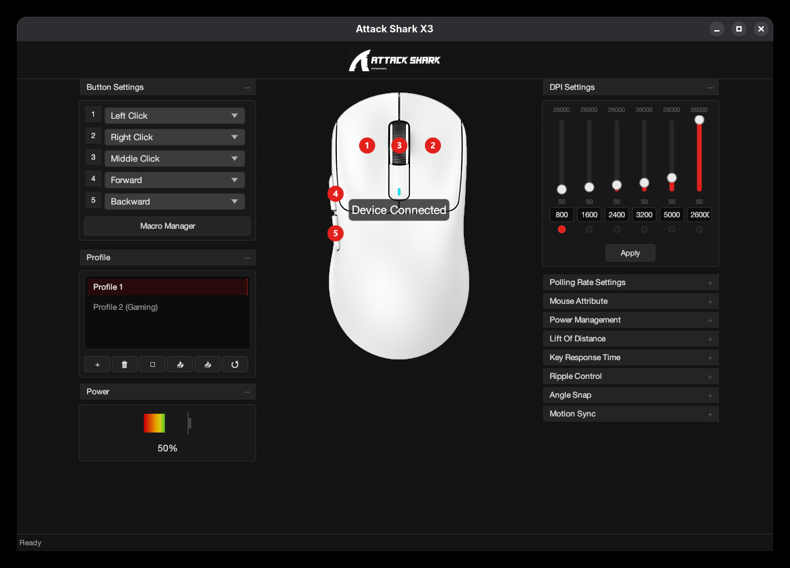

# Attack Shark X3 — Native Linux Driver & GUI

[](https://opensource.org/licenses/MIT)
[](https://www.rust-lang.org/)
[-blue.svg)]()

A native, independent, and open-source **Rust** implementation for complete configuration of the **Attack Shark X3** mouse on Linux, without relying on Wine or proprietary Windows software.




---

## Features

- **DPI Configuration**:
  - DPI stages adjustment (50 to 26,000 DPI in steps of 50).
  - Enable/disable and active stage selection.
  - Individual RGB color indicators for each DPI level.
- **Performance and Sensor (PixArt PAW3395)**:
  - Polling rate: 125 Hz, 250 Hz, 500 Hz, and 1000 Hz.
  - Lift-Off Distance (LOD): 1 mm and 2 mm.
  - Button response time (Debounce): 2 to 50 ms.
  - Ripple Control (On/Off).
  - Angle Snapping (On/Off).
  - Motion Sync (On/Off).
- **Power Management**:
  - Sleep time: 0.5 to 30 minutes.
  - Deep sleep time: 1 to 60 minutes.
  - Real-time battery level and voltage reading via HID.
- **Button Remapping**:
  - Individual configuration of the 5 physical buttons (Left Click, Right Click, Middle Click, Forward, and Back).
  - Multimedia functions, web navigation, DPI cycling, and custom shortcuts (key combinations).
- **Hardware Macros**:
  - Creation of key sequences and saving to the mouse firmware (Slot 2).
  - Direct execution by hardware without relying on software injection into the system.
- **Profiles and Persistence**:
  - Profile creation, switching, deletion, and restoration.
  - Automatic persistence in `~/.config/attack-shark-x3/config.toml`.
- **Native Graphical Interface**:
  - Built with `egui/eframe`, using X11 or XWayland in Wayland sessions (GNOME, KDE Plasma, XFCE, etc.).
  - Faithful visual reproduction of the original DuiLib interface.

---

## Installation and Execution

Use a package built for your CPU architecture. Native packages install the menu
entry, icon, runtime dependencies and mouse permissions automatically:

- **Debian / Ubuntu:** open the `.deb` in the system package installer, or run
  `sudo apt install ./attack-shark-x3_1.0.0_amd64.deb`.
- **Fedora:** open the `.rpm` in the system package installer, or run
  `sudo dnf install ./attack-shark-x3-1.0.0-1.x86_64.rpm`.
- **Arch:** install the generated `.pkg.tar.zst` with `sudo pacman -U ./attack-shark-x3-*.pkg.tar.zst`.
- **AppImage:** allow the file to run as a program and launch it. Required application
  libraries are bundled. If mouse access is missing, the app opens the system
  authentication dialog and configures access automatically. The GUI runs as your
  normal user; only the permission helper requests administrator access.

The title bar follows your desktop's window manager. Closing the window hides it
in a working system tray; the tray can restore it or quit the application.
On desktops without a tray host, closing exits normally. GNOME's availability of
tray icons depends on the desktop session; the app does not install or enable
Shell extensions.

Portable builds target **glibc 2.35 or newer** on standard Linux desktops with
X11/XWayland, udev/logind and a graphics driver. See
[compatibility](docs/compatibility.md) for scope and validation limits. This is
not a claim of support for every Linux version or libc implementation.

### Building from source

For development, use Rust **1.90+** and the udev development headers (HIDAPI is compiled into the binary):

```bash
# Fedora
sudo dnf install gcc pkgconf-pkg-config systemd-devel
# Debian / Ubuntu
sudo apt install build-essential pkg-config libudev-dev
# Arch
sudo pacman -S base-devel rust systemd

cargo build --release --locked
./target/release/attack-shark-x3
```

A source checkout can install permissions using `bash scripts/install-udev.sh`.
This developer step is already handled by the distributed native packages and
the AppImage's first-run setup.

For package builders, ABI baseline checks and automated installation tests, see
[packaging](docs/packaging.md).

---

## Project Structure

```text
attacksharkx3-linux/
├── Cargo.toml
├── README.md
├── LICENSE
├── assets/                  # Original visual assets and icons
├── docs/
│   ├── reverse-engineering.md  # Detailed reverse engineering report
│   ├── usb-protocol.md         # Complete HID protocol specification
│   └── compatibility.md        # Compatibility with distros and environments
├── packaging/
│   ├── udev/                   # Udev rules (70-attack-shark-x3.rules)
│   ├── desktop/                # .desktop shortcut for system menu
│   ├── deb/                    # Script to generate .deb package
│   ├── rpm/                    # Spec file to generate .rpm package
│   └── appimage/               # Script to generate AppImage
├── scripts/
│   └── install-udev.sh         # Helper script for installing permissions
├── src/
│   ├── main.rs                 # Executable entry point
│   ├── lib.rs                  # Reusable Rust library
│   ├── app.rs                  # Main eframe application loop
│   ├── protocol/               # Encoding and decoding of HID packets
│   │   ├── constants.rs
│   │   ├── checksum.rs         # 16-bit big-endian checksum calculation
│   │   ├── sensor.rs           # Report 0x04 (DPI, LOD, sensor)
│   │   ├── power.rs            # Report 0x05 (Sleep and debounce timers)
│   │   ├── polling.rs          # Report 0x06 (Polling rate)
│   │   ├── buttons.rs          # Report 0x08 (18-slot mapping)
│   │   ├── macro_upload.rs     # Report 0x09 (Macro block upload)
│   │   └── battery.rs          # Report 0x03 (Battery/voltage reading)
│   ├── device/                 # HID detection and communication via hidapi
│   ├── dpi/                    # Business rules and DPI validation
│   ├── buttons/                # Button actions and remapping
│   ├── macros/                 # Macro manager
│   ├── profiles/               # Profile manager
│   ├── config/                 # TOML persistence
│   └── gui/                    # egui/eframe visual components
└── tests/
    └── protocol_tests.rs       # Automated protocol and checksum tests
```

---

## Automated Tests

The project includes unit and integration tests that validate every byte of the constructed packets against real captures from the reference software:

```bash
cargo test
```

---

## License

Distributed under the [MIT](LICENSE) license.
